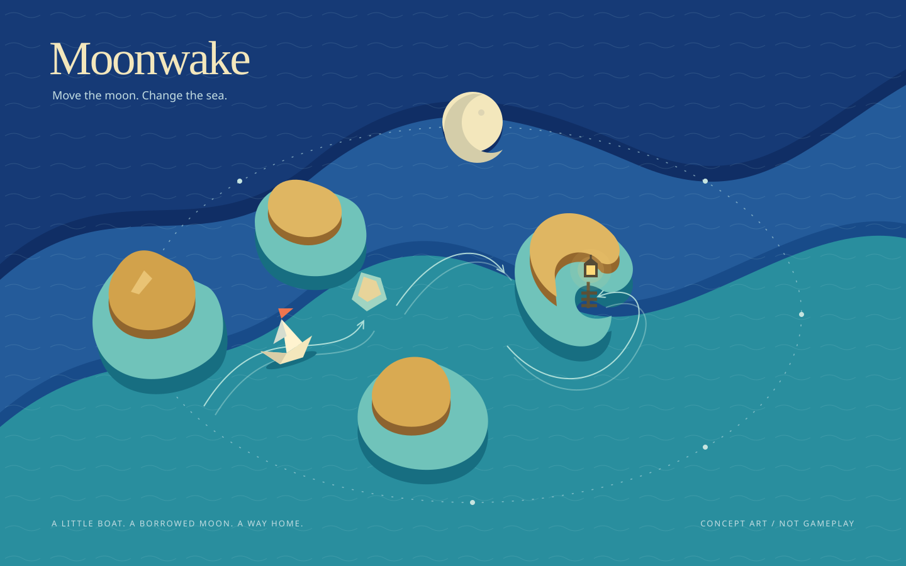

# Moonwake

**Move the moon. Change the sea. Bring a little boat home.**

Moonwake is a concept for a turn-based tidal puzzle game made entirely with HTML, CSS, and vanilla JavaScript. No dependencies, no build step, no backend.

*Original concept illustration, not a screenshot of a playable game.*

## The game

A paper boat is lost in an archipelago that changes with the tide. You cannot steer it directly. Instead, you move the moon around the islands, changing the water beneath it.

At low tide, sandbars emerge and narrow channels close. At high tide, hidden passages open, but currents can carry the boat past the harbor. Each lunar move advances the night. Find the sequence that brings your boat home before dawn.

The puzzle is not how quickly you react. It is knowing when to open a passage, when to let the current carry you, and when to wait.

## How a voyage would work

1. **Read the water.** Study the boat, harbor, sandbars, and current markings on a small, single-screen island map.
2. **Preview a lunar move.** Choose the moon's next position and see the resulting tide, open channels, and boat route before committing.
3. **Let the sea move you.** Advance one turn: the tide changes and the boat follows the indicated current.
4. **Reach the lantern.** Enter the harbor before the turn budget runs out.

The proposed first version would use handcrafted, deterministic puzzles: the same position and move always produce the same result. Undo and restart would let players experiment without punishment. Early voyages would introduce one rule at a time; later ones would combine tidal gates, branching currents, and carefully timed crossings.

The exact moon positions, turn budgets, and current-resolution rules remain to be designed and playtested.

## A world made of paper and water

Imagine a miniature nautical theater viewed from above:

- Broad layers of cobalt and sea-green paper form the water, with exposed edges giving the tide a visible depth.
- Ochre islands sit above shallow turquoise shelves; low tide reveals pale sandbar bridges.
- Fine, engraved-looking lines show current direction. Arrowheads and patterns communicate the rules alongside color.
- A small folded boat with a vermilion pennant travels toward an amber harbor lantern.
- An ivory moon travels along a dotted orbital track framing the map. Its position is both the main control and the explanation for the changing sea.

The board should be the first thing you see, not an illustration behind a menu. The memorable moment: moving the moon makes a strip of water peel away like paper, exposing the sandbar that redirects your boat into the harbor.

This imagery can be drawn with inline SVG and CSS. No downloaded textures, external fonts, image services, or graphics libraries are needed. Motion would clarify each turn, with a reduced-motion alternative that updates the same state immediately.

## Built for the browser

The intended implementation is deliberately small:

- **HTML** for the game shell, instructions, and accessible controls.
- **CSS** for the layered-paper world, responsive layout, and transitions.
- **Vanilla JavaScript** for the turn-based simulation, puzzle definitions, previews, and undo history.
- **Inline SVG** for the islands, moon, boat, current markings, and lanterns.

The goal is to open `index.html` directly in a modern browser and play, without an installation or network connection. Keyboard controls, labeled lunar positions, and a text description of each turn should make the underlying puzzle understandable without relying on animation or color alone.

## Current status

**Concept only.** This repository contains the game description and original visual concept. There is no playable build, `index.html`, or finished level set yet.
